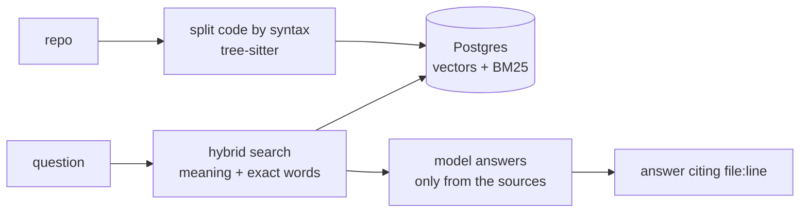

# docgen

**Ask questions about any codebase and get answers that cite the exact lines they came from.**

<!-- Demo: add docs/demo.gif here (ask a question, click a citation). -->

A retrieval-augmented generation (RAG) system for code: it indexes a repository, finds the code relevant to a question with hybrid search, and has a model answer only from that code, linking every claim to `file:line`. It can also write a documentation hub for a whole repo.

**Built with** Python · Postgres (pgvector, ParadeDB BM25) · LangChain · LangGraph · tree-sitter · fastembed · FastAPI · Docker · GitHub Actions · Claude or local models via Ollama

## How it works



An **Agentic** mode wraps this in a [LangGraph](https://github.com/langchain-ai/langgraph) workflow that checks its own work: it reranks the sources, rewrites the search when nothing relevant turns up, and retries an answer that cites nothing.

## Highlights

- **Hybrid search in one database.** Vector search (pgvector) finds code by meaning, BM25 (ParadeDB) by exact names, and the two rankings are fused. Together they find the right file for 88% of held-out questions, against 81% for vector search alone.
- **Every choice measured.** About 100 labelled questions on two repos: settings are tuned on one and reported on the other. That caught two ideas that looked good and weren't: search weights that didn't carry over between repos, and a planned reranker that made results worse.
- **Code-aware chunking.** Splitting files at function and class boundaries with tree-sitter instead of fixed windows raised vector search's hit rate from 61% to 83%.
- **A self-checking agent.** The LangGraph mode's citation check took answers that cite their sources from 50% to 100%, for 8 seconds more a question.
- **Built like a service.** Incremental re-indexing kept consistent by database transactions, one-command Docker setup, and 227 tests that run offline in CI against the same Postgres image.

## Results

Held-out repo ([gitsummarize](https://github.com/antarixxx/gitsummarize), 48 questions), local qwen2.5-coder 7B model:

| | Result |
|---|---|
| Right file in the top 5 search results | **88%** (vector only: 81%) |
| Right code chunk in the top 5 | **79%** |
| Answers citing a correct file, Quick → Agentic mode | 50% → **90%** (first 10 questions) |

Every number and the decision it led to: [docs/evaluation.md](docs/evaluation.md).

## Limitations and next steps

- Measured with a small local model; the next step is the same evals with Claude, including whether a tool-using agent then beats fixed retrieval.
- Answer *quality* isn't scored yet: the local judge model proved unreliable, and a stronger one needs checking against a person's grades first.
- For one developer, an AI coding agent in the IDE is the stronger tool. This approach pays off when many people ask questions, when they don't use such tools, or when code can't leave the machine.

## Run it

```bash
docker compose up --build
open http://127.0.0.1:8765
```

Scan `/repos/example_multilang` or any public GitHub URL, click **Update search index**, and ask away, with an Anthropic API key or a free local model through [Ollama](https://ollama.com). The [guide](docs/guide.md) covers everything else: Agentic mode, the documentation hub, how the search works, and development.
