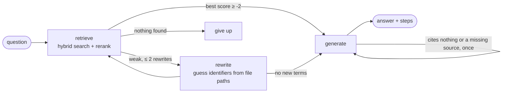

# docgen guide

How to use docgen, and how it works inside. For the overview, see the [README](../README.md); for the measurements, [evaluation.md](evaluation.md).

- [Running it](#running-it)
- [Asking questions](#asking-questions)
- [Building the hub](#building-the-hub)
- [The search index](#the-search-index)
- [Using a free local model (Ollama)](#using-a-free-local-model-ollama)
- [Which files are read](#which-files-are-read)
- [Development](#development)
- [Other notes](#other-notes)

## Running it

```bash
docker compose up --build        # docgen + Postgres (pgvector, ParadeDB pg_search)
open http://127.0.0.1:8765
```

1. **Scan** a repo: `/repos/example_multilang` (a small sample app), a folder under `/repos` (see below), or any public GitHub URL.
2. Pick a provider: Anthropic with a pasted API key, or Ollama with no key.
3. On the **Hub** tab, click **Update search index**, and optionally **Build hub** for written summaries.
4. Ask on the **Ask** tab.

To ask about your own code, mount the folder that holds it: `DOCGEN_REPOS=~/code docker compose up`, then scan `/repos/<project>`. GitHub clones are kept in a Docker volume. Ollama runs on your machine, not in Docker (Docker can't use a Mac's GPU), and the container reaches it through `host.docker.internal`. The UI and the database are published on `127.0.0.1` only.

## Asking questions

The **Ask** tab answers questions about the repo. The best search results (8 by default, at most 3 of them hub summaries, so broad questions still get code to cite) go into the prompt as numbered sources, and the model is told to answer only from them and to cite each claim like `[2]`. Each citation becomes a link such as `store.py:12-30`; clicking it opens that file in the Hub with the cited lines shown. **Retrieved sources** lists everything search found, which ones were cited, and each one's rank in the vector and keyword halves (and its rerank score in Agentic mode), so you can see why an answer was good or bad.

**Questions about the whole repo** ("give me an overview of this repo", "what does this project do?") work differently: no single chunk answers them, so search alone returns whatever shares a word with the question. For those, the repo's overview material goes first: the hub's overview and root-folder summaries if the hub was built, then the README's summary and its sections from the top. Agentic mode skips its relevance check for them, since overview material never scores well against "give me an overview". Building the hub's overview makes these answers much better than the README alone.

The index is updated before each question (quick when little changed), but it has to exist first: click **Update search index** in the Hub tab once. The default model is `claude-sonnet-5-5`, at a few cents a question; with Ollama it's free, with a smaller prompt to fit the local model's context. Each question is answered on its own, with no memory of earlier ones.

```bash
python -m docgen.ask path/to/repo "How are GitHub repos cloned?" --sources
python -m docgen.agent path/to/repo "How are GitHub repos cloned?" --provider ollama   # Agentic, printing each step
```

### Agentic mode

**Mode: Agentic** runs the same pipeline as a [LangGraph](https://github.com/langchain-ai/langgraph) graph that checks its own work (`docgen/agent.py`):



- **retrieve** reorders hybrid search's top 20 with a local cross-encoder reranker (`docgen/rerank.py`, ms-marco-MiniLM-L-12-v2 through fastembed). Its top score is the relevance check, so no model call is spent grading sources.
- **rewrite** shows the model the repo's file paths and what earlier searches found, and searches again for the question plus the names it guesses.
- **generate** uses Quick mode's prompt; an answer citing nothing, or a source that doesn't exist, is retried once with a note saying what was wrong.

The decisions are rules in code, not choices by the model: a small local model chose badly what to read when given tools ([evaluation.md](evaluation.md#rag-against-a-tool-using-agent)). The UI lists the steps taken under the answer. With `LANGSMITH_TRACING=true` and `LANGSMITH_API_KEY` set, every node and model call also goes to LangSmith. Quick stays the default: with a local 7B model, Agentic takes 30 to 90 seconds a question.

## Building the hub

The hub explains a whole repo in any language, bottom-up:

1. **Files.** Each file gets a summary (purpose, key components, dependencies, what uses it). Its context is the repo files it imports, the files that import it, and its folder neighbors; imports are found for Python and JavaScript/TypeScript. Files too long for one prompt are summarized in overlapping sections, then merged. Files under 30 lines get no call of their own; their text goes into their directory's prompt.
2. **Directories**, deepest first, from their files' and subdirectories' one-line purposes.
3. **Overview**: what the repo does, stack, architecture, entry points, data flow, business rules, how to run, plus a Mermaid diagram. A diagram that fails a basic syntax check gets one repair attempt, and is left out (with a note) if that fails too.

It takes one model call per file (more for long files), so a repo of a hundred files is a few minutes and a few cents to a few dollars with Claude, which runs calls in parallel, but hours with a local model, one call at a time. Three ways to make it lighter:

- **Summarize only the files you pick.** Select a file in the Hub tab and click **Summarize this file**: one call, no folder or overview summaries.
- **Use a smaller local model for files.** The file model and the top model (folders and overview) are set separately. On a 16 GB M4, `qwen2.5-coder:3b` summarized files in about 10 seconds against 44 for the 7B, with summaries nearly as good (5 files compared side by side; the 7B adds a little more of the why).
- **Leave out what you don't want documented** with a `.docgenignore` (see [Which files are read](#which-files-are-read)), such as long design docs.

```bash
export ANTHROPIC_API_KEY=sk-ant-...
python -m docgen.hub path/to/repo                      # Claude: claude-haiku-5-5 for files, claude-opus-5-5 above
python -m docgen.hub path/to/repo --provider ollama    # local and free, one call at a time
```

It prints the number of model calls and a rough cost estimate (leaning high, since the models' thinking can't be predicted) and asks before spending anything; at the end it prints what was actually spent, from the API's token counts. Use `--file-model` / `--top-model` to pick models, `--yes` to skip the question, `--regenerate` to redo everything, and `--export` to write Markdown afterwards.

Results go to `path/to/repo/.docgen/hub.json`. Each summary is saved as soon as it's done, under a key built from what it was made from, so:

- Running again only redoes files whose text changed, plus the directories above them and the overview.
- Ctrl+C keeps everything finished so far; run again to continue.
- A reply in the wrong format is recorded under `errors` and retried on the next run; a setup problem (bad key, unknown model, Ollama not running) stops the run.

**In the web UI**, the Hub tab shows the repo as a tree, with a dot per file and folder: green is summarized, yellow means the code changed since, red means the last attempt failed, and hollow is a small file covered by its folder's summary. Click anything to read its summary; the root shows the overview and the diagram's Mermaid source. **Build hub** shows the call count and estimated cost and asks before starting; the build runs in the background with a progress bar (a long file shows each section as it's done) and a **Stop** button that takes effect before the next model call and keeps everything done so far.

**GitHub repos.** A public `https://github.com/owner/repo` URL is shallow-cloned into `~/.cache/docgen/owner/repo` (or `$DOCGEN_CACHE_DIR`), and each Scan pulls the latest commit. The hub cache lives in the clone, so a rebuild after new commits only redoes what changed. If the pull fails (offline, say), the existing copy is used with a warning.

**Markdown export** (or `--export`) writes one `README.md` per folder: the top one has the overview, the diagram as a `mermaid` code block (GitHub draws these) and the root folder; each folder's README has its role, a table of what's in it, and its files' summaries, with links to the source. A local repo exports to `docs/hub/`, which the walker always skips so the hub never summarizes its own output; a GitHub repo exports to `./output/owner-repo/`.

## The search index

Each repo's index is a Postgres table (`docgen/store.py`), one row per entry, holding its text, metadata and embedding. There are two types of entry:

- **Code chunks** from every file the walker reads, split along the code's own structure. Every chunk records its file and line range, which answers cite.
  - **Python** is split with `ast` into top-level functions and classes (with their decorators and leading comments). Long classes are split into methods, and the code between definitions is kept as "module" chunks.
  - **TypeScript, JavaScript, Go, Rust, Java, C#, Ruby, PHP, Kotlin, Swift, C/C++** and a few more are parsed with [tree-sitter](https://tree-sitter.github.io/) and split the same way: functions, classes, interfaces, types, structs and `const Page = () => {...}` components become chunks named after what they define. A definition over 120 lines is split into what it contains, such as a React component's inner handlers. Each grammar downloads on first use (a few MB); set `DOCGEN_TREE_SITTER=0` to turn this off.
  - **Markdown** is split at headings, and each chunk keeps its heading path, such as `Install > macOS`.
  - **Everything else**, and any file a parser can't handle, is split into 60-line windows that overlap by 10 lines.
- **Summary parts**: the hub's file, folder and overview summaries, split at their headings.

```bash
python -m docgen.repo_index path/to/repo                       # update
python -m docgen.repo_index path/to/repo --query "how are GitHub repos cloned"
```

Only files and summaries whose text changed since the last run are embedded again: the repo's manifest (a row in the `docgen_repos` table) keeps each one's hash, and is saved in the same transaction as the rows it lists, so the two can't disagree after a crash. Changing the chunking rules or the embedding model rebuilds the whole index. Run it again after building the hub so the new summaries are included.

The embedding model is all-MiniLM-L6-v2, run locally by [fastembed](https://github.com/qdrant/fastembed) (ONNX Runtime, no PyTorch; about 90 MB). It reads only the first 256 word pieces of a chunk. `DOCGEN_EMBEDDINGS=hash` swaps in an offline embedder that matches shared words rather than meaning; the tests use it.

### Hybrid search

`docgen/search.py` runs both searches and merges them with reciprocal rank fusion: each result scores 1 / (60 + rank) in every list it appears in. RRF only looks at ranks, so cosine distances and BM25 scores never need to be made comparable. `HYBRID_ALPHA` can weight the two lists, but stays at 0.5 (plain RRF; see [evaluation.md](evaluation.md#weighting-the-two-halves)). The server exposes it at `GET /api/search?repo=...&q=...&mode=hybrid|vector|keyword`.

Both halves are SQL against the repo's table. The vector half is [pgvector](https://github.com/pgvector/pgvector): an HNSW index ordered by cosine distance, with iterative scans so filters (summaries only, excluded paths) still return a full list. BM25 comes from [ParadeDB's pg_search](https://github.com/paradedb/paradedb), which runs the Tantivy search engine inside Postgres. It indexes a `keywords` column holding docgen's own tokens, split only at spaces, since its standard tokenizers don't split identifiers and docgen's does, so `make_hub_models` also matches "hub models". Each repo has its own table so BM25's word statistics are that repo's alone.

`RepoRetriever` wraps the whole search as a LangChain retriever (`RepoRetriever(repo_path=...).invoke(question)` returns `Document`s with the citation in their metadata). LangChain's own `BM25Retriever` and `EnsembleRetriever` were considered, but they live in `langchain-community`, which LangChain sunset in May 2026, and `langchain-classic`.

## Using a free local model (Ollama)

You don't need an Anthropic key. [Ollama](https://ollama.com) runs open models on your own machine, free and offline after the model is downloaded.

```bash
ollama pull qwen2.5-coder:7b      # once, several GB; then choose "Ollama" as the provider
```

- **Model choice:** the default `qwen2.5-coder:7b` runs on most machines. A smaller model such as `qwen2.5-coder:3b` is about twice as fast, which helps for the many file summaries of a hub build; with 24 GB of GPU memory, `qwen2.5-coder:32b` gives noticeably better results.
- **Server location:** `http://localhost:11434` by default; set `OLLAMA_HOST` to use another machine.
- **One call at a time:** hub builds with Ollama run sequentially, and prompts are kept smaller to fit the local model's context. docgen asks Ollama for an 8192-token window, because its small default would silently cut off long prompts.
- **Quality:** small open models are more likely than Claude to describe things the code doesn't show, or to ignore the required output format (those summaries are recorded as errors and retried on the next build).
- **How it's wired:** both providers are LangChain chat models (`ChatAnthropic`, `ChatOllama`) behind one `complete(system, user)` function in `docgen/llm.py`, so the rest of docgen doesn't know which is in use.

## Which files are read

docgen walks the whole repo and reads every text file, in any language, except:

- Anything matched by `.gitignore`, or by a `.docgenignore` (same syntax, for things you want in git but not in the docs). Both are honored in subdirectories too, as in git.
- `node_modules`, `.venv`, `venv`, `dist`, `build`, `.git`, `.docgen` and cache folders, even without a `.gitignore`, plus `docs/hub` (the hub's own export).
- Lockfiles (`package-lock.json`, `poetry.lock`, `*.lock`, ...), minified files (`*.min.*`), source maps and SVG images.
- Binaries, files that aren't UTF-8, files over 200 KB, and symlinks (never followed).

Each file's language comes from its extension, looked up by tree-sitter-language-pack, with a short list of overrides in `docgen/walker.py` for names it doesn't know, such as `Dockerfile`. **Scan** lists how many files were read per language and every file skipped by the last two rules, with the reason.

## Development

To work on docgen's code, run it on your machine against the same database. Requires Python 3.12+ and [uv](https://docs.astral.sh/uv/).

```bash
docker compose up -d db                        # just the database
uv run python -m docgen.web                    # the app from your checkout, at http://127.0.0.1:8765
uv run ruff check                              # lint
DOCGEN_EMBEDDINGS=hash uv run pytest -q        # tests (fish: env DOCGEN_EMBEDDINGS=hash uv run pytest -q)
```

`uv run` installs the exact versions in `uv.lock` the first time. Set `DOCGEN_DATABASE_URL` to use another Postgres (it needs the `vector` and `pg_search` extensions). Your Anthropic key is sent only with each hub build or question and is never written to disk.

The tests create their own `docgen_test` database, fresh each run. Models are faked (including a small fake Ollama server), the offline hash embedder stands in for MiniLM, and a local git repo stands in for GitHub, so the suite runs offline and costs nothing. GitHub Actions runs lint and tests on every push to `main`, with the same ParadeDB image as a service container.

| Module | Role |
|---|---|
| `repos.py`, `walker.py` | Turn a path or GitHub URL into a folder; pick the files to read |
| `chunking.py`, `embeddings.py` | Split files along their structure; embed text (MiniLM via fastembed) |
| `repo_index.py`, `store.py` | Keep the index in step with the repo; the Postgres tables and search SQL |
| `search.py`, `rerank.py` | Hybrid search with RRF (and a LangChain retriever); the cross-encoder reranker |
| `ask.py`, `agent.py`, `llm.py` | Quick answers; the LangGraph Agentic mode; ChatAnthropic / ChatOllama behind one function |
| `hub.py`, `imports.py`, `hub_export.py` | The documentation hub, the import graph it uses, Markdown export |
| `evaluate.py`, `answer_eval.py` | Search evals; answer evals |
| `web.py`, `web_static/index.html` | The FastAPI server and single-page UI |

## Other notes

- The UI is a plain dark dev-tool page with no external fonts or scripts (its Markdown renderer is built in), so it works with no internet access.
- Imports are found with patterns for Python and JavaScript/TypeScript only; files in other languages get their folder neighbors as context instead.
- Line numbers for tree-sitter chunks come from byte offsets, because reading a node's `start_point.row` crashes Python with py-tree-sitter 0.26.0.
- **Update search index** runs inside the request, so the page waits while a large repo is embedded for the first time: about 10 minutes for 1,100 files (14,000 chunks), on the CPU with both search indexes updated row by row. Later updates only redo changed files.
- The diagram is shown as Mermaid source in the web UI, not drawn.
